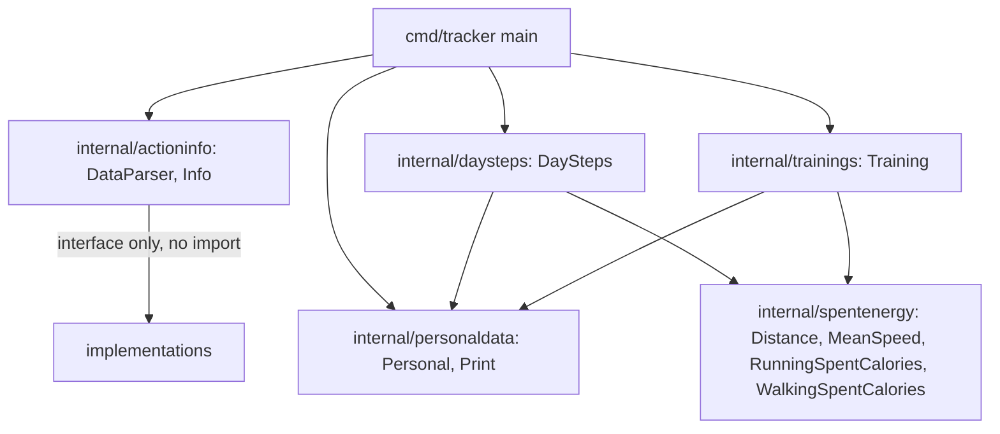
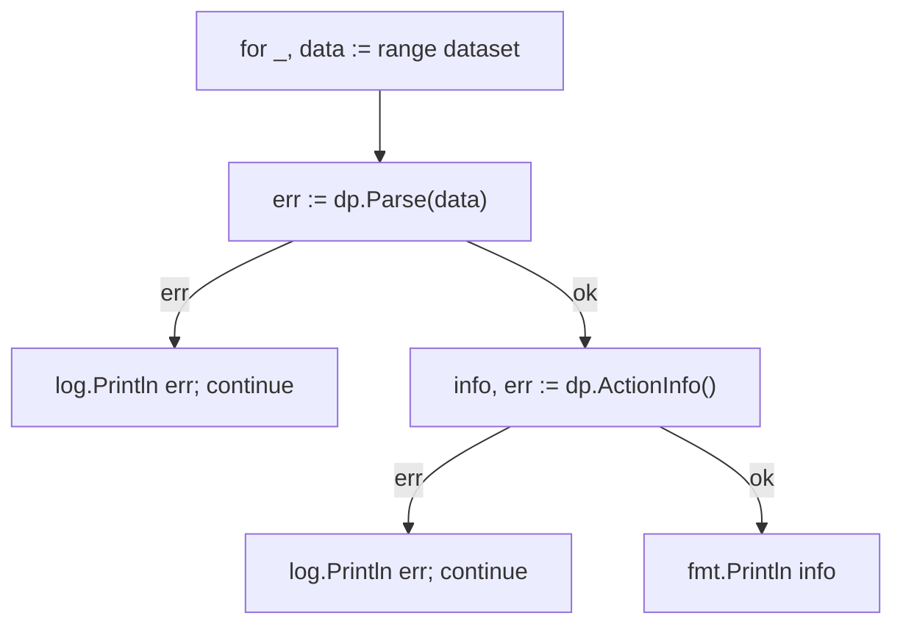

# План выполнения: Модуль фитнес-трекера (sprint5-final)

Источники: [`TASK_DESCRIPTION.md`](TASK_DESCRIPTION.md), [`README.md`](README.md) и юнит-тесты
`*_test.go` (тесты — единственный источник истины по валидации, форматам и округлению; изменять их запрещено).

## 1. Цель и границы

Реализовать модуль фитнес-трекера в шаблоне [`go1fl-sprint5-final-k-konovalov-copy`](.) так, чтобы
`go mod tidy && go test -v ./...` проходил полностью.

Ограничения:

- Редактируем только 5 файлов реализации в [`internal/`](internal): `spentenergy`, `personaldata`, `trainings`, `daysteps`, `actioninfo`.
- [`cmd/tracker/main.go`](cmd/tracker/main.go:1) не трогаем.
- Тесты `*_test.go` не трогаем.
- Внешние зависимости не добавляем (уже есть `testify`).

## 2. Архитектура и зависимости пакетов



### Слои связности (по данным `codegraph`)

Связанность измерена в индексе CodeGraph (`.codegraph`, `codegraph impact <symbol>`) и в графе импортов
(`go list -f '{{.ImportPath}}: {{join .Imports " "}}' ./...`). Учитываются только символы проекта,
тесты — по факту обращений к реализации.

| Символ | Кто зависит (без собственных тестов) | Связанность |
|---|---|---|
| `Distance`, `MeanSpeed`, `RunningSpentCalories`, `WalkingSpentCalories` | только свои тесты | 0 — лист |
| `Personal` / `Print` | `cmd/tracker` (main), `personaldata`-тест | 1 (+ main) |
| `Training` | `cmd/tracker` (main), `trainings`-тест | 1 (+ main) |
| `DaySteps` | `cmd/tracker` (main), `daysteps`-тест | 1 (+ main) |
| `Info` | `cmd/tracker` (main), `actioninfo`-тест | 1 (+ main) |
| `DataParser` | `Info`, `cmd/tracker` (main), мок в `actioninfo`-тесте | 2 |

Импортный граф (`go list`) на текущих заглушках подтверждает слои:

- `internal/spentenergy` → только `time` (stdlib);
- `internal/personaldata`, `internal/daysteps`, `internal/trainings`, `internal/actioninfo` → без импортов
  (после реализации добавятся ровно `personaldata`/`spentenergy` у слоя 2 и ничего у `actioninfo`);
- `cmd/tracker` → `actioninfo`, `daysteps`, `trainings`, `personaldata` (`spentenergy` — транзитивно).

Отсюда порядок реализации — **по возрастанию связанности**:

1. `spentenergy` — 0 зависимых символов, единственный импорт — stdlib `time`.
2. `personaldata` — независимый пакет, но его тип встраивается в слой 2 и печатается из `main`.
3. `trainings`, `daysteps` — зависят только от слоя 1 (равная связанность, порядок произволен).
4. `actioninfo` — зависит только от собственного интерфейса; реализации ему не импортируются.

Правила, следующие из раскладки:

- **Интерфейс объявляет потребитель**: `DataParser` живёт в [`actioninfo`](internal/actioninfo/actioninfo.go:1),
  `trainings`/`daysteps` о нём не знают и лишь имеют подходящие методы (утиная типизация).
- **Оркестратор не импортирует реализации** — цикл зависимостей невозможен по построению.
- **Структуры — только хранилища данных** (`Personal`, `Training`, `DaySteps`); полиморфизм достигается
  интерфейсом, а не `switch` по типу и не рефлексией.

## 3. Контракты по пакетам (выведены из ТЗ и тестов)

### 3.1 [`internal/spentenergy/spentenergy.go`](internal/spentenergy/spentenergy.go:1)

Константы уже заданы: `mInKm = 1000`, `minInH = 60`, `stepLengthCoefficient = 0.45`,
`walkingCaloriesCoefficient = 0.5`.

| Функция | Поведение |
|---|---|
| `Distance(steps int, height float64) float64` | `float64(steps) * height * stepLengthCoefficient / mInKm` |
| `MeanSpeed(steps int, height float64, duration time.Duration) float64` | если `duration <= 0` → `0`; иначе `Distance(...) / duration.Hours()` |
| `RunningSpentCalories(...) (float64, error)` | валидация → `0, err`; иначе `weight * MeanSpeed(...) * duration.Minutes() / minInH` |
| `WalkingSpentCalories(...) (float64, error)` | то же, что `Running...`, затем `* walkingCaloriesCoefficient` |

Правила валидации для `Running/WalkingSpentCalories` (по тестам):

- `steps <= 0` → ошибка (0 шагов и отрицательные шаги — ошибка);
- `weight <= 0` → ошибка;
- `height <= 0` → ошибка (для `Running` тест проверяет только отрицательный рост, для `Walking` — нулевой и отрицательный; правило `height <= 0` покрывает оба);
- `duration <= 0` → ошибка (в `Running` проверяются 0 и отрицательные).

Замечание: тест `TestDistance` ожидает точное `assert.Equal` для `1000/1.75` — значит порядок
арифметических операций должен давать ровно `0.7875` (умножать `steps` на `height` и коэффициент,
делить на `mInKm`; коэффициент — не целочисленная константа, приведение `steps` к `float64` обязательно).

### 3.2 [`internal/personaldata/personaldata.go`](internal/personaldata/personaldata.go:1)

- `Personal{ Name string; Weight float64; Height float64 }` — экспортируемые поля.
- `func (p Personal) Print()` — вывод строго через `fmt.Printf` с двумя знаками после запятой:
  `Имя: %s\nВес: %.2f\nРост: %.2f\n`. Тест читает `os.Stdout` через `os.Pipe`, поэтому писать только в stdout.

### 3.3 [`internal/trainings/trainings.go`](internal/trainings/trainings.go:1)

Структура:

- `Steps int`, `TrainingType string`, `Duration time.Duration`, встроенная `personaldata.Personal`.

`Parse(datastring string) (err error)`:

1. `strings.Split(datastring, ",")`; длина должна быть ровно `3`, иначе ошибка.
2. Шаги: `strconv.Atoi(parts[0])` — ошибка при нечисловом значении и при `+`/`-` без цифр; результат `<= 0` → ошибка.
   `Atoi` отклоняет пробелы по краям, поэтому строки вида `" 12345"`/`"12345 "` падают естественным образом.
3. `TrainingType = parts[1]`.
4. `time.ParseDuration(parts[2])` — ошибка при неверном формате; результат `<= 0` → ошибка.
   `ParseDuration` покрывает `"5m"`, `"2h"`, `"1.5h"`, `"30.5m"`, `"1 h30m"`, `"30"`, `"1.5d"`.
5. При ошибке поля не должны содержать «мусор» (тесты на ошибки проверяют только `err`, но записывать поля имеет смысл только после успешной валидации).

`ActionInfo() (string, error)`:

1. `distance := spentenergy.Distance(t.Steps, t.Height)`; `speed := spentenergy.MeanSpeed(t.Steps, t.Height, t.Duration)`.
2. `switch t.TrainingType`: `"Бег"` → `RunningSpentCalories`, `"Ходьба"` → `WalkingSpentCalories`,
   `default` → `return "", errors.New("неизвестный тип тренировки")`.
3. Ошибку из расчёта калорий возвращаем вместе с пустой строкой.
4. Формат строки (все float — `%.2f`, часы — `Duration.Hours()`):

```text
Тип тренировки: <TrainingType>
Длительность: %.2f ч.
Дистанция: %.2f км.
Скорость: %.2f км/ч
Сожгли калорий: %.2f
```

### 3.4 [`internal/daysteps/daysteps.go`](internal/daysteps/daysteps.go:1)

Структура: `Steps int`, `Duration time.Duration`, встроенная `personaldata.Personal`.

`Parse(datastring string) (err error)`:

1. `strings.Split(datastring, ",")`; длина ровно `2`, иначе ошибка.
2. `strconv.Atoi(parts[0])`; ошибка или значение `<= 0` → ошибка.
3. `time.ParseDuration(parts[1])`; ошибка или значение `<= 0` → ошибка.

`ActionInfo() (string, error)`:

1. `distance := spentenergy.Distance(ds.Steps, ds.Height)`.
2. `calories, err := spentenergy.WalkingSpentCalories(ds.Steps, ds.Weight, ds.Height, ds.Duration)`;
   при ошибке — `return "", err`.
3. Формат:

```text
Количество шагов: %d.
Дистанция составила %.2f км.
Вы сожгли %.2f ккал.
```

### 3.5 [`internal/actioninfo/actioninfo.go`](internal/actioninfo/actioninfo.go:1)

- `type DataParser interface { Parse(datastring string) error; ActionInfo() (string, error) }`.
  Имена параметра в интерфейсе не влияют на совместимость — мок в тесте использует `Parse(data string)`.
- `func Info(dataset []string, dp DataParser)`:



- Ошибки логируем в `log` (тест подменяет `log.SetOutput`), успешный результат — `fmt.Println` в stdout
  (тест ожидает `"processed test data\n"`). Пустой `dataset` → ничего не печатаем.
- Важно: `Info` принимает интерфейс, поэтому `daysteps`/`trainings` не импортируются (нет циклических зависимостей).
  В `main.go` передаются указатели `&daySteps`, `&trains` — значит `Parse` должен быть на указателе, а `ActionInfo` — на значении
  (набор методов указателя включает методы значения).

## 4. Пошаговый план реализации

Порядок шагов — по возрастанию связанности из §2 (данные `codegraph impact`): сначала символы с
нулевым числом зависимых, затем их потребители, затем оркестратор, который знает о реализациях только
через интерфейс. Порядок внутри одного слоя произволен — пакеты слоя независимы.

### Слой 0. Подготовка и измерение связности

1. **Подготовка окружения**: `cd go1fl-sprint5-final-k-konovalov-copy && go mod tidy`; зафиксировать
   базовое состояние тестов (ожидаемо — компиляционные ошибки из-за заглушек).
2. **Измерение связности** (повторяемо): `codegraph index .`, затем `codegraph impact <symbol>` для каждого
   экспортируемого символа; параллельно `go list -f '{{.ImportPath}}: {{join .Imports " "}}' ./...`.
   Критерий совпадения со слоями §2: у `spentenergy` в импортах только stdlib, у `actioninfo` —
   ни одного `internal/...`, у `trainings`/`daysteps` — только `personaldata`/`spentenergy`.
   Расхождение => корректируем план **до** написания кода.

### Слой 1. Символы с нулевой связанностью

3. **`spentenergy`** (связанность 0, импорт только `time`): `Distance`, `MeanSpeed`,
   `RunningSpentCalories`, `WalkingSpentCalories` + валидация. Чистые функции без состояния.
   Проверка: `go test ./internal/spentenergy/`.
4. **`personaldata`** (независимый пакет): `Personal{Name, Weight, Height}` + `Print()` с `%.2f`.
   Структура-хранилище, интерфейсов не объявляем. Проверка: `go test ./internal/personaldata/`.
   Идёт после `spentenergy`, потому что от `spentenergy` зависят оба пакета слоя 2, а `Personal` — только
   как встраиваемый тип; так слой 2 разблокируется сразу целиком.

### Слой 2. Потребители слоя 1 (связанность 1)

5. **`trainings`**: `Training` (хранилище данных, встраивает `Personal`), `Parse` на указателе,
   `ActionInfo` на значении, формат и ошибка `неизвестный тип тренировки`. Методы обязаны удовлетворять
   `DataParser`, но интерфейс здесь **не объявляем** — его объявляет потребитель.
   Проверка: `go test ./internal/trainings/`.
6. **`daysteps`**: `DaySteps` + `Parse` + `ActionInfo` по тому же принципу.
   Проверка: `go test ./internal/daysteps/`.

### Слой 3. Оркестратор (только интерфейс, без импортов реализаций)

7. **`actioninfo`**: объявить `DataParser` (связанность 2 — единственный символ, на который ссылаются
   и код, и мок теста) и реализовать `Info(dataset []string, dp DataParser)` с логированием ошибок.
   Единственная зависимость — стандартная библиотека. Проверка: `go test ./internal/actioninfo/`.
8. **Проверка контракта без правок кода**: `*trainings.Training` и `*daysteps.DaySteps` реализуют
   `actioninfo.DataParser` неявно — это подтверждает [`main.go`](cmd/tracker/main.go:38), передающий их в
   `Info`, и успешный `go build ./...`. Контроль направления зависимостей:
   `go list -f '{{join .Imports " "}}' ./internal/actioninfo` не содержит `internal/trainings|internal/daysteps`.

### Слой 4. Сквозная проверка и финализация

9. **Сквозная проверка**: `go build ./...`, `go vet ./...`, `go test -v ./...` из корня модуля.
10. **Проверка на гонки данных**: `go test -race ./...` — дополнительная проверка безопасности, особенно важно для
    [`TestPrint`](internal/personaldata/personaldata_test.go:12) и [`TestInfo`](internal/actioninfo/actioninfo_test.go:28),
    которые подменяют `os.Stdout` и `log` из другой горутины.
11. **Ручной smoke-прогон**: `go run ./cmd/tracker` — убедиться, что невалидные строки логируются, а валидные выводятся; `main.go` не менялся.
12. **Финализация**: `gofmt -l .` (пусто), `codegraph sync .` для обновления индекса, проверить `git status` —
    изменены только 5 файлов реализации (+ `PLAN.md`, `CODE_PATTERN.md`); служебный `.codegraph/` в коммит не попадает.

## 5. Критерии готовности

- [ ] `go test -v ./...` — все пакеты PASS, без изменений в тестах.
- [ ] `go build ./...` и `go vet ./...` — без ошибок и предупреждений.
- [ ] `gofmt` не находит неформатированных файлов.
- [ ] Экспортируемые имена и сигнатуры совпадают с ТЗ (`Distance`, `MeanSpeed`, `RunningSpentCalories`, `WalkingSpentCalories`, `Personal`, `Training`, `DaySteps`, `DataParser`, `Info`).
- [ ] Направление зависимостей соответствует слоям §2: `actioninfo` не импортирует `internal/...`, `trainings`/`daysteps` — только `personaldata`/`spentenergy`.
- [ ] `cmd/tracker/main.go` и все `*_test.go` не изменены.

## 6. Риски и контрольные точки

| Риск | Митигация |
|---|---|
| Расхождение с точным `assert.Equal` в `TestDistance` | сохранить порядок операций: `float64(steps) * height * coefficient / mInKm` |
| Ошибки валидации `Parse` на краевых вводах (`+12345`, `" 12345"`, `1h-30m`) | полагаться на `strconv.Atoi` и `time.ParseDuration`, не обрезать пробелы, не использовать `TrimSpace` |
| Вывод `Print` и `ActionInfo` сравнивается строго (`Equal`) | использовать `fmt.Printf`/`fmt.Sprintf` с `%.2f` и ровно теми строками-шаблонами из тестов |
| `Info` логирует вместо возврата ошибки | использовать `log.Println` (тест подменяет вывод `log`) |
| Неизвестный тип тренировки | вернуть `errors.New("неизвестный тип тренировки")` и пустую строку |
| «Удобный» импорт реализации в оркестратор (`actioninfo` → `trainings`) | `go list` на импорты `actioninfo`: ни одного `internal/...`; интерфейс объявлен у потребителя |
| Разрастание `DataParser` «на будущее» | интерфейс содержит ровно методы, нужные `Info`; реализация подстраивается под него, а не наоборот |
| Соблазн вынести «общие» типы в `util`/`common` | типы-хранилища живут в своих пакетах (`Personal` в `personaldata`), общее опускается вниз по графу |
| Устаревший индекс CodeGraph после правок | `codegraph sync .` перед повторной оценкой связности (шаг 2) |
